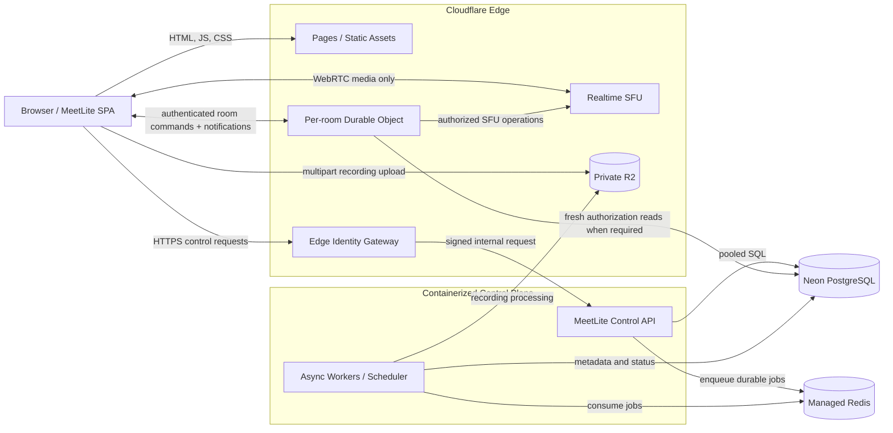
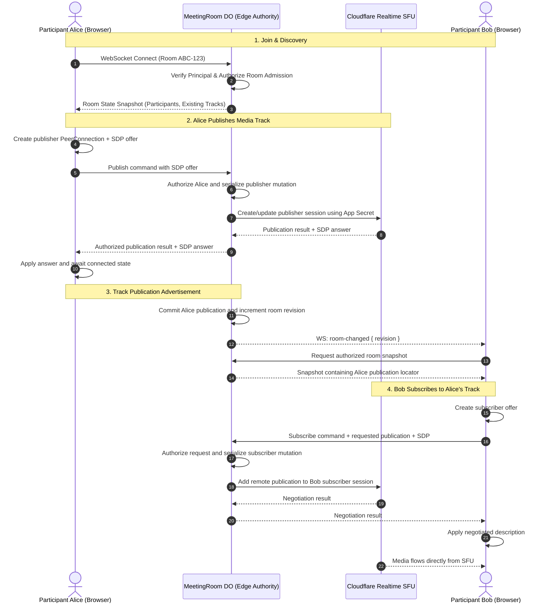
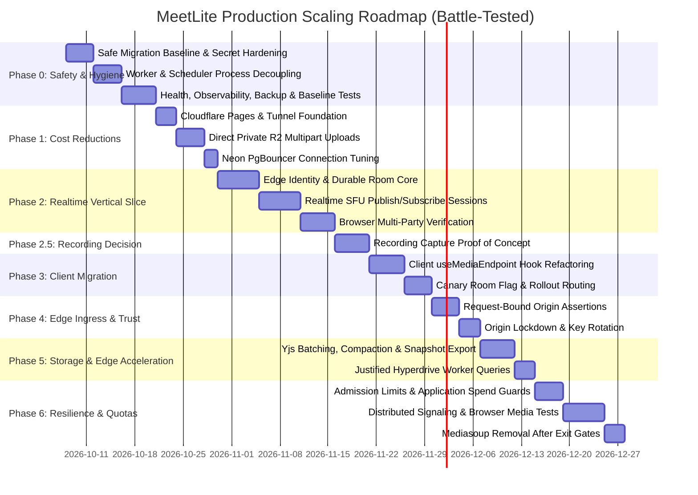

# MeetLite: Master Production Scaling Blueprint (Zero-Waste to 200k CCU)

---

## Execution Documents

This blueprint defines the target architecture and sequence. Implementation is governed by three agent-executable documents:

- [Scaling execution plan](execution/scaling-execution-plan.md)
- [Refactoring execution plan](execution/refactoring-execution-plan.md)
- [Strict coding rules and caged verification loop](execution/README.md)

The blueprint is not itself authorization to skip a phase gate. When a checklist conflicts with the execution standard, the stricter safety or verification requirement applies.

---

## 1. Executive Summary & Architectural Philosophy

### 1.1 The Product & System Context
**MeetLite** is a modern, privacy-respecting, high-performance real-time collaboration and video conferencing platform.
The platform combines:
- **WebRTC Video & Audio Conferencing**: Multi-party rooms with simulcast video routing, screen sharing, and active speaker detection.
- **Real-Time Collaboration**: Shared infinite-canvas whiteboards (Tldraw), collaborative rich text/code editing (Yjs CRDT), in-room chat, and emoji reactions.
- **Enterprise Control Plane**: Multi-tenant organizations, workspace teams, granular role-based access control (RBAC), subscription tiers (Free, Pro, Enterprise), and audit logs.
- **Asynchronous AI Services**: Meeting summarization, automated action item extraction, and audio transcription.

### 1.2 The Economic & Operational Dilemma
Traditional video conferencing architectures are operational and financial traps for early-stage and growing products:
1. **The Idle Compute Burn**: Pre-provisioning dedicated Kubernetes clusters or bare-metal SFU fleets (e.g. Mediasoup or Jitsi servers) burns **thousands of dollars every month** when active user count is near zero.
2. **The Cloud Bandwidth Trap**: Traditional cloud providers (AWS, GCP, Azure) charge $0.05 to $0.09 per GB of outbound bandwidth. Streaming multi-party video through these clouds at scale costs upwards of hundreds of thousands of dollars per month in egress fees alone.
3. **The Stateful Scaling Bottleneck**: Naively clustering stateful Node.js WebSocket servers using central Redis Pub/Sub creates catastrophic fan-out bottlenecks when 50,000 rooms broadcast chat, awareness, and whiteboard events simultaneously.

### 1.3 The Core Architectural Thesis: "Cloudflare-Native, Scale-to-Zero"
To achieve sustainability at day 1 and resilience during viral surges, MeetLite adheres to a disciplined principle:
> **"Design for an inexpensive path from 0 users to 200,000 peak concurrent users—optimizing for Cloudflare's serverless edge primitives, deep domain seams, and usage-based billing rather than maintaining idle infrastructure or speculative multi-cloud abstractions."**

- **At 0 Users (Pre-Launch & Quiet Periods)**: Active compute cost can approach **$0.00 – $5.00/month**, excluding retained database/object storage, domain registration, logs, and paid-plan minimums.
  - Frontend static assets are served from global edge caches with zero server charges.
  - Media SFU incurs $0 because zero minutes are consumed.
  - PostgreSQL compute scales down to zero when idle via Neon.
  - Recording storage incurs $0 egress fees via Cloudflare R2.
- **At Growth & Surge Scale (Up to 200k CCU)**:
  - Traffic is absorbed elastically across Cloudflare’s 300+ Anycast edge locations.
  - Room coordination is isolated per-room using Cloudflare Durable Objects.
  - Media routing is delegated to Cloudflare Realtime SFU.
  - Origin database connections are multiplexed through Neon PgBouncer. Worker queries use Hyperdrive only when traces show that edge-to-database access is actually required.
- **Commercial Safeguards**: Because managed per-GB egress ($0.05/GB) scales linearly, we establish hard commercial review gates at **$10k, $50k, and $250k/month** to evaluate committed volume discounts or dedicated media offloading before costs expand unbounded.

### 1.4 How the Production System Fits Together

MeetLite is divided into six operational planes. These are ownership divisions, not six independently deployable microservices.



#### Plane A — Delivery

Cloudflare Pages serves the React application. Static delivery has no dependency on the control API, PostgreSQL, Redis, or the realtime room path. A temporary origin outage must not prevent the SPA shell from loading.

#### Plane B — Identity and control

The control plane owns users, organizations, subscriptions, scheduled meetings, invitations, recording metadata, audit logs, and other durable business data. Requests enter through the Edge Identity Gateway, which validates the public access token and forwards a request-bound internal assertion through Cloudflare Tunnel. The containerized control API remains horizontally scalable and does not hold active meeting state in memory.

#### Plane C — Realtime room coordination

One Durable Object owns one active room's serialized state transitions: admission, membership, publication discovery, moderator actions, reconnection generations, and pending SFU cleanup. The Durable Object is the authority for room state; it is not the media server.

#### Plane D — Media transport

Cloudflare Realtime SFU forwards audio, video, and screen-share tracks. Each participant owns two browser `RTCPeerConnection` instances: one publisher connection and one subscriber connection. The browser creates SDP offers and applies answers, but only the trusted Worker/Durable Object calls the Realtime SFU REST interface with the App Secret. Once negotiated, media flows directly between browser and SFU without passing through MeetLite containers or the Durable Object.

#### Plane E — Durable data and storage

Neon PostgreSQL stores relational business state. Durable Object SQLite stores room-local coordination state required after hibernation or restart. Private R2 stores large immutable objects such as recordings, thumbnails, and exported collaboration snapshots. Each datastore has one explicit role; Redis is not a source of truth.

#### Plane F — Asynchronous work

Email, notifications, video processing, transcription, summarization, retention, and scheduled recurrence run in independently scalable worker and scheduler processes. HTTP replicas never start queue consumers or cron schedules implicitly.

### 1.5 Trust Boundaries

The system uses the following non-negotiable trust rules:

1. Browser-provided `userId`, `orgId`, role, room membership, track ownership, and object keys are untrusted locators—not authorization evidence.
2. The Cloudflare Realtime App Secret, R2 credentials, database credentials, and internal assertion keys never reach browser code.
3. A Worker or Durable Object authorizes every SFU create, publish, subscribe, layer-change, and close operation.
4. A room connection is bound to a verified principal during upgrade. Later WebSocket messages derive the sender from that connection rather than accepting a sender ID in the payload.
5. Every database query includes the tenant scope derived from the verified principal. Resource IDs alone never authorize access.
6. Internal assertions are short-lived and bound to an audience, HTTP method, path, and unique request ID to limit replay.

### 1.6 End-to-End Runtime Flows

#### Flow 1 — Load the application and authenticate

1. The browser downloads immutable assets from Pages.
2. Login or refresh requests pass through the Edge Identity Gateway to the control API over Cloudflare Tunnel.
3. The control API validates credentials and issues a 15-minute asymmetric access token plus a rotating, hashed refresh-token family.
4. Ordinary stateless requests accept the access token until expiry. Security-sensitive global revocation uses a session-version lookup; the plan does not claim instant revocation without consulting a revocation store.

#### Flow 2 — Join a meeting room

1. The browser requests a short-lived, single-use room capability from the control API.
2. The capability contains the room ID, verified subject, tenant, permitted room role, expiry, and unique token ID. It does not contain the Cloudflare App Secret.
3. The browser presents the capability when upgrading its WebSocket to the room Worker.
4. The Worker resolves the Durable Object by canonical room ID and forwards the verified principal.
5. The Durable Object enforces meeting existence, tenant entitlement, capacity, and moderation policy, then creates a durable membership generation.
6. The socket serializes a small attachment containing its membership ID and generation so identity survives hibernation.
7. The Durable Object returns the authoritative room snapshot and current revision.

#### Flow 3 — Publish camera, microphone, or screen share

1. The browser creates or reuses its publisher `RTCPeerConnection`, adds local tracks, creates an SDP offer, and sends a publish command to the room backend.
2. The Durable Object verifies that the connection owns the membership and is allowed to publish the requested track kind.
3. The trusted backend creates/updates the publisher SFU session through `https://rtc.live.cloudflare.com/v1/apps/{appId}` using the App Secret.
4. The backend returns the SDP answer to the browser, which applies it and waits for the PeerConnection to reach `connected`.
5. Only after successful negotiation does the Durable Object commit the publication to its room catalog and increment the room revision.
6. Other members receive a lightweight `room-changed` notification and fetch or receive the authorized updated snapshot.

#### Flow 4 — Subscribe to remote media

1. The client selects desired publications based on layout, active speaker, visibility, and bandwidth.
2. It creates an offer on its subscriber `RTCPeerConnection` and requests those publications through the room backend.
3. The Durable Object verifies membership and that every requested publication is visible to that member.
4. The backend serializes mutations for that subscriber SFU session, calls the SFU, and returns the negotiated description.
5. The browser applies the answer and renders tracks delivered directly by the SFU.

#### Flow 5 — Chat, presence, and collaborative documents

1. Chat and moderator commands go through the room WebSocket and are authorized against the socket-bound membership.
2. Replaceable high-frequency state such as cursors is batched and may be dropped when stale.
3. Durable chat or document mutations are assigned sequence/revision numbers before broadcast.
4. Yjs updates are batched into Durable Object SQLite, periodically compacted into snapshots, and exported to R2 at lifecycle checkpoints. Awareness state remains ephemeral.
5. On hibernation, in-memory caches disappear; the socket attachments and SQLite state reconstruct the room implementation when it wakes.

#### Flow 6 — Record and process a meeting

Recording capture is a separate architectural decision from R2 storage. Phase 2.5 must choose and validate one capture model: designated-browser composite recording, a server-side WebRTC recorder participant, or per-track capture with later composition. After capture:

1. The control API authorizes an upload and allocates a tenant-scoped private R2 object key.
2. The browser or recorder uploads multipart chunks directly to the R2 S3 endpoint.
3. The control API validates and completes the multipart upload, writes metadata, and enqueues processing.
4. Independent workers create thumbnails, transcribe, summarize, enforce retention, and update status idempotently.
5. Playback is authorized per request and proxied or signed through a Worker/custom-domain access mechanism; S3 presigned URLs are not presented as custom-domain URLs.

### 1.7 Architectural Decision Record

| Decision | Why this choice | Consequence / tradeoff | Revisit trigger |
| :--- | :--- | :--- | :--- |
| **Cloudflare-first rather than multi-cloud media abstraction** | Lowest operational burden and strong current unit economics for uncertain traffic; also aligns with the project's learning goal. | Cloudflare-specific room and negotiation implementation; regional/provider incidents remain a dependency. | Material reliability failure, missing required capability, or commercial review gate. |
| **Managed Realtime SFU instead of self-hosted Mediasoup in production** | Avoid idle SFU/TURN fleets, UDP load balancing, regional capacity management, and emergency provisioning. | Linear egress cost and reliance on Cloudflare limits/support. | $10k/$50k/$250k gates and measured sustained utilization. |
| **One Durable Object per room** | Room commands require a single serialization point, while rooms scale independently. | A single hot room is still one stateful partition; placement affects global participants. | Webinar/hot-room workloads exceed tested per-room limits. |
| **Separate publisher and subscriber PeerConnections** | Independent negotiation lifecycles reduce glare and make recovery easier. | Two sessions and PeerConnections per participant; slightly more client/backend state. | Browser measurements demonstrate a simpler bidirectional topology is equally reliable. |
| **Control API stays containerized initially** | Existing Express/Prisma logic can be hardened without rewriting all business behavior for Workers. | Some requests still traverse Tunnel to an origin deployment. | Traces identify high-volume, edge-suitable logic worth moving. |
| **Neon PostgreSQL remains the durable business source of truth** | Relational tenant, billing, scheduling, and authorization data already fit PostgreSQL and Prisma. | It is a regional consistency point and requires deliberate indexes, pooling, backups, and migrations. | Proven database bottleneck after query/index/pool optimization. |
| **DO SQLite owns only room-local durable state** | Hibernation-safe room state stays colocated with its coordinator without turning PostgreSQL into a heartbeat/event store. | Data is partitioned by room and should not become the system of record for billing or organizations. | Cross-room queries or compliance requirements cannot be met through exported summaries. |
| **R2 stores immutable large objects; it does not define recording capture** | Direct multipart transfer removes large payloads from Node memory and origin bandwidth. | A separate recorder design and processing pipeline are still required. | Phase 2.5 recording decision. |
| **Redis is a queue/cache, never authoritative room state** | Queue consumers and transient caches benefit from Redis; realtime room authority belongs in DOs. | Redis failure degrades async work and some notifications but should not corrupt room truth. | A workflow needs stronger durable execution guarantees than BullMQ provides. |
| **No Kubernetes initially** | Workers, DOs, managed SFU, Pages, R2, Neon, and a small container origin cover the required scaling seams with less idle cost and operator burden. | Fewer low-level scheduling controls. | Multiple always-on container workloads make a scheduler economically and operationally simpler. |
| **Evolutionary scale gates instead of a one-shot 200k launch** | Capacity risk comes from distributions, reconnect storms, hot rooms, quotas, and cost—not only nominal CCU. | Each phase requires measurement and can pause the roadmap. | Never removed; this is the operating model. |

### 1.8 Ownership Invariants

- PostgreSQL owns durable business facts: who the user is, which tenant owns a meeting, entitlements, billing records, recording metadata, and audit history.
- A room Durable Object owns the current serialized room lifecycle and the mapping from authorized membership to active publication locators.
- The browser owns capture devices, UI state, and its two PeerConnections.
- Realtime SFU owns transport sessions and packet forwarding, but not MeetLite identity, rooms, permissions, or durable history.
- R2 owns object bytes; PostgreSQL owns the metadata and authorization rules describing those objects.
- Queue workers own retriable processing execution; job handlers must be idempotent because delivery is at least once.
- No module infers authority from a locator such as room ID, user ID, session ID, track name, recording ID, or object key.

---

## 2. Accurate Mathematical & Economic Capacity Model

### 2.1 The Room & User Distribution
Video conferencing is an **embarrassingly parallel problem** segmented by rooms:
- **Target Peak Concurrency**: $200,000 \text{ concurrent active users (CCU)}$
- **Average Meeting Size**: $4 \text{ participants}$
- **Simultaneous Rooms**: $\frac{200,000}{4} = \mathbf{50,000\text{ independent concurrent rooms}}$
- **Large Meeting / Webinar Edge Case**: Up to 100 participants per enterprise room, with an explicitly enforced webinar mode limiting publisher permissions. Layer selection reduces subscriber bandwidth but does not by itself prevent every participant from publishing.

```
       ┌────────────────────────────────────────────────────────┐
       │             200,000 Concurrent Active Users            │
       └───────────────────────────┬────────────────────────────┘
                                   │
                 Partitioned across 50,000 Rooms
                 (Avg 4 Participants / Room)
                                   │
        ┌──────────────────────────┴──────────────────────────┐
        ▼                                                     ▼
┌───────────────────────────────┐             ┌───────────────────────────────┐
│       Room #1 (4 Users)       │     ···     │     Room #50,000 (4 Users)    │
│  - 1 Cloudflare Durable Object│             │  - 1 Cloudflare Durable Object│
│  - 8 Realtime SFU Sessions    │             │  - 8 Realtime SFU Sessions    │
│    (publish + subscribe/user) │             │    (publish + subscribe/user) │
│  - No room-state coupling     │             │  - No room-state coupling     │
└───────────────────────────────┘             └───────────────────────────────┘
```

### 2.2 Bandwidth & Stream Calculations

#### A. Video Ingress (Participant Publishing)
Each active participant publishes 1 audio stream and 1 video stream (using 3-layer WebRTC Simulcast):
- **Audio Track**: Opus @ 40 kbps
- **Video Track (Simulcast Total)**:
  - High Layer (720p @ 30fps): ~1,200 kbps
  - Medium Layer (360p @ 30fps): ~450 kbps
  - Low Layer (180p @ 15fps): ~150 kbps
  - *Effective publishing bitrate with dynamic adaptation*: ~750 kbps average.
- **Total Ingress per User**: $750\text{ kbps} + 40\text{ kbps} = \mathbf{790\text{ kbps}}$
- **Total Global Ingress at 200k CCU**: $200,000 \times 790\text{ kbps} = \mathbf{158\text{ Gbps}}$

#### B. Video Egress (Participant Receiving)
In a 4-person room, each user receives media from the other 3 participants:
- Downstream Audio: $3 \times 40\text{ kbps} = 120\text{ kbps}$
- Downstream Video:
  - 1 Active Speaker (High 720p): ~1,200 kbps
  - 2 Grid Participants (Low 180p thumbnails): $2 \times 150\text{ kbps} = 300\text{ kbps}$
  - Screen sharing / video headroom: ~400 kbps
- **Total Egress per User**: $1,200 + 300 + 120 + 400 \approx \mathbf{2.02\text{ Mbps}}$
- **Total Global Egress at Peak**: $200,000 \times 2.02\text{ Mbps} = \mathbf{404\text{ Gbps}}$

---

### 2.3 Unit Economics & Media Pricing Model

#### The Unit Cost per Participant-Minute
A user receiving 2.02 Mbps consumes:
$$\frac{2.02 \times 10^6 \text{ bits/sec}}{8 \text{ bits/byte}} = 252,500 \text{ bytes/sec} \approx 0.2525 \text{ MB/sec}$$
$$\text{Egress per minute} = 0.2525 \text{ MB/sec} \times 60 \text{ sec} = 15.15 \text{ MB/min} \approx \mathbf{0.01515\text{ decimal GB per participant-minute}}$$

Cloudflare Realtime SFU charges **$0.05 per GB of egress** (with a 1,000 GB/month shared allowance):
$$\text{Cost per participant-minute} = 0.01515\text{ GB} \times \$0.05 = \mathbf{\$0.0007575\text{ per participant-minute}}$$

#### Comparative Market Unit Pricing:
Pricing is an October 2026 public-list snapshot and must be refreshed quarterly and before every commercial gate. Different vendors include different capabilities, support, recording, and volume discounts, so this is directional—not a substitute for a quote.

| Provider | Unit Pricing Model | Cost per Participant-Minute | Idle Monthly Cost |
| :--- | :--- | :--- | :--- |
| **[Cloudflare Realtime SFU](https://developers.cloudflare.com/realtime/sfu/pricing/)** | **$0.05 / GB egress** | **~$0.0007575 at the assumed bitrate** | **$0.00 media usage** |
| **[AWS Chime SDK](https://aws.amazon.com/chime/chime-sdk/pricing/)** | $0.00170 / attendee-minute | $0.00170 | $0.00 media usage |
| **[Daily.co](https://www.daily.co/pricing/video-sdk/)** | Graduated participant-minute pricing | $0.00400 down to $0.00150 at published tiers | $0.00 media usage |

#### Modeling Monthly Cost by Usage (Illustrative Diurnal Scenario vs Theoretical 24/7)
- **Theoretical 24/7 Peak**: 200,000 users active *every second of the month* (404 Gbps continuously) would generate $181,800\text{ GB/hour} \times \$0.05 = \$9,090/\text{hour} \approx \$6.55\text{M/month}$. This is a bounding scenario, not the planning forecast.
- **Illustrative Diurnal Duty Cycle Model** (30-day month, 22 business days):
  - Peak: 200k CCU for 3 hours per business day = 13.2M participant-hours.
  - Shoulder: 40k CCU for 6 hours per business day = 5.28M participant-hours.
  - Off-peak: 5k CCU for the remaining 522 hours = 2.61M participant-hours.
  - Total: ~21.09M participant-hours = ~1.265B participant-minutes.
  - Cloudflare media egress at the assumed bitrate: **approximately $958k/month before negotiated discounts**, less the shared free allowance.
  - At current public list tiers, AWS Chime is approximately $2.15M and Daily is roughly $1.9M+ before negotiated discounts for the same participant-minute volume.
  - This scenario is not a forecast. Replace it with measured concurrency histograms, subscribed bitrates, TURN usage, and contract pricing as production data arrives.

#### Total Infrastructure Cost Progression Across Growth Milestones:
The following table estimates **Cloudflare media egress only** at the assumed subscribed bitrate. Workers, Durable Objects, storage, logs, database, recording, transcription, and support plans are modeled separately.

| Milestone | Concurrency Profile | Monthly Participant-Minutes | Estimated Cloudflare Realtime Egress |
| :--- | :--- | :--- | :--- |
| **Stage 0: Pre-Launch** | 0 users | 0 mins | **$0 media usage** |
| **Stage 1: Alpha** | 20 CCU | 15,000 mins | **$0 within shared allowance** |
| **Stage 2: Early Traction** | 500 CCU | 1,200,000 mins | **~$859** after allowance |
| **Stage 3: Growth** | 5,000 CCU | 25,000,000 mins | **~$18,888** after allowance |
| **Stage 4: Illustrative Surge Month** | Diurnal profile above | ~1,265,400,000 mins | **~$958k** before negotiated discounts |

---

## 3. Core Architecture: Cloudflare Realtime SFU & Durable Objects

### 3.1 Understanding the Cloudflare Realtime SFU Topology
A critical architectural reality that must govern the implementation:
> **In Cloudflare Realtime SFU, a "Session" represents a single participant's PeerConnection endpoint—NOT a meeting room.**

- Cloudflare Realtime SFU does not possess a native "Room" entity.
- MeetLite deliberately uses two sessions per participant: an independent publisher session and subscriber session. This prevents publish and subscribe negotiations from blocking one another.
- The browser owns the corresponding `RTCPeerConnection` instances, but the trusted Worker/Durable Object makes authenticated Realtime REST calls:
  - `POST https://rtc.live.cloudflare.com/v1/apps/{appId}/sessions/new`
- A participant publishes audio/video tracks to their own session:
  - The browser sends its SDP offer to the trusted room backend.
  - The backend calls `POST .../sessions/{publisherSessionId}/tracks/new` with `{ sessionDescription }`.
- To receive media from others, a participant requests Cloudflare to bridge tracks from other sessions into their own session:
  - The browser requests authorized publications through the room backend.
  - The backend calls `POST .../sessions/{subscriberSessionId}/tracks/new` with the remote publisher session and track name.
- The Realtime App Secret exists only in Worker secrets and is never returned to the browser.

### 3.2 The Durable Object as the Authoritative Room Coordinator
Because Cloudflare Realtime SFU does not manage room state, **the Cloudflare Durable Object is the authoritative Room Coordinator**.



### 3.3 Durable Object Responsibilities
1. **Admission & Tenant Quota Control**: Verifies user token, enforces maximum room capacity (e.g. 50 participants), checks organization subscription tier.
2. **Catalog of Published Tracks**: Maps a durable membership generation to trusted publisher session and track locators.
3. **Serialized Negotiation Ordering**: Serializes mutations independently for each publisher and subscriber session. Concurrent activity in different sessions can proceed in parallel.
4. **Reconnection & Generation Tracking**: When a client network drops, the DO tracks connection generations (`generationId: 3`), invalidating stale renegotiation offers.
5. **Session Teardown & SFU Cleanup**: Explicit leave closes promptly. Abandoned sessions expire through heartbeat detection and retryable cleanup records; cleanup is not assumed to occur immediately on every network loss.
6. **Collaborative State**: Coordinates Tldraw/Yjs updates and ephemeral awareness. Socket identity survives hibernation through serialized attachments, while required room state is persisted in DO SQLite.

---

## 4. Deep Domain Module Seams

To avoid leaky abstractions and speculative multi-cloud complexity, we discard generic, artificial interfaces like `IMediaProvider`. Instead, we structure the codebase around **4 deep domain modules**:

```
                       ┌─────────────────────────┐
                       │     MEETLITE CORE       │
                       └────────────┬────────────┘
         ┌──────────────────┬───────┴──────────┬──────────────────┐
         ▼                  ▼                  ▼                  ▼
┌──────────────────┐┌──────────────────┐┌──────────────────┐┌──────────────────┐
│ RoomCoordinator  ││  MediaEndpoint   ││RecordingPipeline ││ IdentityVerifier │
│  (State Engine)  ││ (WebRTC SFU API) ││ (Presigned R2)   ││ (Zero-Trust JWT) │
└──────────────────┘└──────────────────┘└──────────────────┘└──────────────────┘
```

### 4.1 `RoomCoordinator` Interface
Authoritative lifecycle, membership, and publication management (implemented by Cloudflare Durable Object):
```typescript
export interface IRoomCoordinator {
  join(principal: VerifiedPrincipal, capability: RoomCapability): Promise<RoomJoinResult>;
  leave(connection: RoomConnection): Promise<void>;
  publish(connection: RoomConnection, command: PublishCommand): Promise<PublishResult>;
  subscribe(connection: RoomConnection, command: SubscribeCommand): Promise<SubscribeResult>;
  withdraw(connection: RoomConnection, publicationId: string): Promise<void>;
  send(connection: RoomConnection, event: RoomEvent): Promise<void>;
  getSnapshot(connection: RoomConnection, revision?: number): Promise<RoomSnapshot>;
  terminate(connection: RoomConnection): Promise<void>;
}

export interface TrackPublication {
  publicationId: string;
  kind: 'audio' | 'video' | 'screen';
  simulcast: boolean;
  ownerMembershipId: string;
}
```

`RoomConnection` is created by the trusted implementation during the authenticated WebSocket upgrade. Browser messages never supply their own `userId`, tenant, role, or sender identity. Provider session IDs and track names remain private implementation data and appear only in authorized snapshots when the browser needs them for negotiation.

### 4.2 `MediaEndpoint` Interface
Manages the participant's WebRTC peer connection and track bindings (implemented by Cloudflare Realtime SFU client driver):
```typescript
export interface IMediaEndpoint {
  connect(roomCapability: string): Promise<ConnectedRoomMedia>;
  publish(source: LocalMediaSource, options?: PublishOptions): Promise<Publication>;
  subscribe(publicationIds: string[]): Promise<RemoteMediaSet>;
  unsubscribe(publicationId: string): Promise<void>;
  setPreferredLayer(publicationId: string, layer: 'high' | 'medium' | 'low'): Promise<void>;
  replaceConnection(reason: ReconnectReason): Promise<ReconnectResult>;
  close(): Promise<void>;
}
```

This is a browser-side module. Its implementation owns both PeerConnections, SDP queues, stale-generation rejection, media event handling, and calls to the trusted room backend. It does not contain the Realtime App Secret or call authenticated SFU REST operations directly.

### 4.3 `RecordingPipeline` Interface
Direct, secure browser-to-R2 streaming with server-authorized object allocation:
```typescript
export interface IRecordingPipeline {
  beginUpload(principal: VerifiedPrincipal, recording: RecordingIntent): Promise<{
    uploadId: string;
    objectKey: string;
    partSize: number;
  }>;
  authorizePart(principal: VerifiedPrincipal, uploadId: string, partNumber: number): Promise<PresignedPart>;
  finalize(principal: VerifiedPrincipal, uploadId: string, parts: CompletedPart[]): Promise<RecordingRecord>;
  authorizePlayback(principal: VerifiedPrincipal, recordingId: string): Promise<PlaybackGrant>;
}
```

Object keys are allocated by the implementation and never accepted from an untrusted caller. Part URLs are issued lazily or in small batches rather than pre-generating an unbounded URL array.

### 4.4 `IdentityVerifier` Interface
Edge-authenticated identity asserting cryptographically signed claims without trusting spoofable plain HTTP headers:
```typescript
export interface IIdentityVerifier {
  verifyToken(token: string): Promise<VerifiedPrincipal>;
  issueRoomCapability(principal: VerifiedPrincipal, roomId: string): Promise<string>;
  signInternalRequest(principal: VerifiedPrincipal, request: RequestIdentity): Promise<string>;
  verifyInternalRequest(assertion: string, request: RequestIdentity): Promise<VerifiedPrincipal>;
}

export interface VerifiedPrincipal {
  userId: string;
  orgId: string;
  role: 'owner' | 'admin' | 'member' | 'guest';
  tokenVersion: number;
  expiresAt: number;
}
```

Internal assertions include issuer, audience, issued/expiry timestamps, request ID, HTTP method, normalized path, and a key ID. The implementation strips all client-provided identity/assertion headers and supports overlapping keys during rotation.

---

## 5. Comprehensive Phased Implementation Roadmap



Durations are planning estimates rather than commitments. Every phase exits through measured acceptance gates; learning or failure findings may extend a phase without forcing the next phase to begin.

---

### Phase 0: Production Safety, Decoupling & Hygiene
**Primary Goal**: Fix critical technical debt, security gaps, and process coupling before deploying edge infrastructure.

#### Work Items & File Locations:
1. **Prisma Migrations (`backend/packages/shared/prisma`)**:
   - Stop using `prisma db push --accept-data-loss` in [docker-compose.yml](../../docker-compose.yml#L53).
   - Back up the current database and successfully restore it into an isolated environment.
   - Generate and review a SQL migration that represents the current schema. Mark that migration as already applied on databases that already contain the schema rather than executing a destructive baseline against them.
   - Update container startup to execute `npx prisma migrate deploy`.
   - Adopt expand/migrate/contract rules: additive compatible schema first, data backfill second, destructive removal only after all old code is gone.
2. **Secret Hardening (`docker-compose.yml` & `.env.example`)**:
   - Remove fallback default passwords (`meetlite_secure_password_2026`) and fallback JWT secrets.
   - Configure services to fail fast on startup with descriptive error if `JWT_SECRET`, `DATABASE_URL`, or `POSTGRES_PASSWORD` is absent.
3. **Decouple Queue Workers & Crons (`room-service` & `auth-service`)**:
   - Extract `NotificationWorker` and `VideoProcessingWorker` out of `room-service/src/index.ts`.
   - Create independent entry point `backend/packages/room-service/src/worker.ts` and dedicated container service `room-worker`.
   - Run recurring meeting schedules from a dedicated scheduler process. Jobs and handlers remain idempotent even when a scheduler lease is retried or briefly duplicated.
4. **Real Readiness Health Checks (`api-gateway`, `auth-service`, `room-service`)**:
   - `/health/live` checks only whether the process event loop is responsive.
   - `/health/ready` checks required PostgreSQL/Redis dependencies with strict timeouts and a short cached result to prevent probe storms.
   - `/health/startup` remains false until configuration validation and required initialization complete.
5. **Token Lifetime & Revocation Semantics (`auth-service`)**:
   - Shorten access token lifetime from 7 days to 15 minutes.
   - Store only hashed refresh tokens; rotate by session family and revoke the family when reuse is detected.
   - Use stateless access-token validation for normal requests, accepting a maximum 15-minute revocation delay.
   - Require a Redis/database session-version lookup for operations that require immediate revocation semantics. Do not claim instant revocation from a self-contained JWT alone.
6. **Observability & Recovery Foundation**:
   - Add a correlation ID spanning Worker, Durable Object, origin request, queue job, and recording pipeline.
   - Emit structured logs and metrics for request latency/errors, queue depth/age, room joins, SFU negotiation, first remote frame, reconnect, cleanup backlog, R2 processing, and estimated media spend.
   - Define initial service-level objectives and alert thresholds before optimization.
   - Document PostgreSQL backup retention, RPO/RTO, and a recurring restore drill.

#### Verification Gate:
- `docker compose run --rm prisma-migrate` applies clean migrations without data loss warnings.
- Scaling `room-service` to 3 replicas runs 3 HTTP listeners while queue jobs process on the separate worker without duplicate notifications.
- Killing PostgreSQL causes `/health/ready` to return HTTP 503 within 2 seconds.
- `/health/live` remains successful during a temporary PostgreSQL failure, allowing the process to recover without a restart loop.
- A production-like database backup restores successfully and passes integrity smoke tests.

---

### Phase 1: Static Edge CDN & Zero-Egress Storage Foundation
**Primary Goal**: Remove all static asset and media upload/download traffic from origin servers.

#### Work Items & File Locations:
1. **Cloudflare Pages & Tunnel Foundation (`client/`, `docker-compose.yml`)**:
   - Verify existing [client/public/_redirects](../../client/public/_redirects) covers SPA fallback (`/* /index.html 200`).
   - Configure Cache-Control headers in `client/public/_headers`:
     ```text
     /assets/*
       Cache-Control: public, max-age=31536000, immutable
     /index.html
       Cache-Control: public, max-age=0, must-revalidate
     ```
   - Add Wrangler configuration `client/wrangler.toml`:
     ```toml
     name = "meetlite-client"
     compatibility_date = "2026-10-01"
     pages_build_output_dir = "dist"
     ```
   - Establish a staging Cloudflare Tunnel route to the API Gateway and verify that origin application ports can be removed from the public firewall. Full request-assertion enforcement remains in Phase 4.
2. **Private R2 Direct Upload Pipeline (`backend/packages/room-service`)**:
   - Refactor [cloudflare-r2.service.ts](../../backend/packages/room-service/src/services/cloudflare-r2.service.ts) to eliminate `Buffer` memory allocation in Node.js.
   - Implement S3 multipart presigned upload URL generator for client browsers:
     - `createMultipartUpload(key, contentType, tenantId)`
     - `getUploadPartUrl(key, uploadId, partNumber)`
     - `completeMultipartUpload(key, uploadId, parts)`
   - Set R2 bucket to **Private** (no public bucket endpoints).
   - Distinguish upload and playback URLs:
     - Multipart presigned upload URLs use the R2 S3 endpoint.
     - Private playback through a custom domain is authorized by a Worker/R2 binding or custom-domain token mechanism; it is not described as an S3 presigned custom-domain URL.
   - Allocate object keys on the trusted backend, enforce tenant prefix, expected content type and maximum size, record checksums, abort expired multipart uploads, and clean orphan objects.
3. **Database Connection Multiplexing (`@minimeet/shared`)**:
   - Update Prisma schema to use Neon's pooled endpoint (`-pooler.postgres.neon.tech`) for application connections:
     ```prisma
     datasource db {
       provider  = "postgresql"
       url       = env("DATABASE_URL")      // Neon PgBouncer pooled endpoint (?pgbouncer=true)
       directUrl = env("DIRECT_URL")        // Direct compute endpoint for migrations
     }
     ```
   - Tune connection pool limit to `connection_limit=10` per service container.

#### Verification Gate:
- Browsers upload a 500MB test recording file directly to R2 using presigned URLs without memory consumption spiking in `room-service`.
- 1,000 concurrent HTTP requests to `room-service` complete with 0 `P1001` database connection timeout errors.
- An unauthorized user cannot allocate, complete, read, or delete an object belonging to another tenant.

---

### Phase 2: Real-Time Edge Vertical Slice (Durable Objects + Realtime SFU)
**Primary Goal**: Build and validate one complete meeting room path running entirely on Cloudflare Workers, Durable Objects, and Realtime SFU.

#### Work Items & File Locations:
1. **Edge Identity and Room Capability (`edge/room-coordinator`)**:
   - Verify the asymmetric access token at the Worker.
   - Exchange normal application identity for a short-lived, single-use room capability bound to room, subject, tenant, permitted role, expiry, and token ID.
   - Reject room identifiers, identities, or roles supplied only in WebSocket message bodies.
2. **Cloudflare Worker & Durable Object Project (`edge/room-coordinator`)**:
   - Initialize Cloudflare Worker with Durable Object binding:
     ```toml
     name = "meetlite-room-coordinator"
     main = "src/index.ts"
     compatibility_date = "2026-10-01"

     [[durable_objects.bindings]]
     name = "MEETING_ROOM"
     class_name = "MeetingRoomDurableObject"

     [[migrations]]
     tag = "v1"
     new_sqlite_classes = ["MeetingRoomDurableObject"]
     ```
3. **`MeetingRoomDurableObject` Class Implementation**:
   - Implements `IRoomCoordinator` with the WebSocket Hibernation API:
     ```typescript
     export class MeetingRoomDurableObject extends DurableObject<Env> {
       constructor(ctx: DurableObjectState, env: Env) {
         super(ctx, env);
         ctx.blockConcurrencyWhile(() => this.restoreDurableRoomState());
       }

       async fetch(request: Request): Promise<Response> {
         const principal = await this.verifyRoomCapability(request);
         const webSocketPair = new WebSocketPair();
         const [client, server] = Object.values(webSocketPair);

         const membership = await this.admit(principal);
         server.serializeAttachment({
           membershipId: membership.id,
           generation: membership.generation,
         });
         this.ctx.acceptWebSocket(server, [membership.id]);
         return new Response(null, { status: 101, webSocket: client });
       }

       async webSocketMessage(ws: WebSocket, message: string | ArrayBuffer) {
         const attachment = ws.deserializeAttachment();
         await this.handleAuthorizedCommand(attachment, message);
       }

       async webSocketClose(ws: WebSocket, code: number) {
         const attachment = ws.deserializeAttachment();
         await this.markDisconnectedAndScheduleCleanup(attachment);
       }
     }
     ```
   - Persist membership generations, room revisions, publication locators, moderation state, and pending cleanup records in DO SQLite during this phase—not after rollout.
4. **Cloudflare Realtime SFU Server Driver**:
   - Helper utility interacting with Cloudflare REST API:
     - `createPublisherSession()` and `createSubscriberSession()` allocate independent participant sessions.
     - `publishTracks(publisherSessionId, authorizedOffer)` returns the negotiated result.
     - `subscribePublications(subscriberSessionId, authorizedRequests, description)` serializes subscriber mutations.
     - `closeParticipantSessions()` records per-item results and retries incomplete cleanup.
   - All calls target `https://rtc.live.cloudflare.com/v1/apps/{appId}` and execute only in trusted Worker code with the App Secret stored as a Worker secret.
5. **End-to-End Vertical Slice Test Harness**:
   - Deploy test room to Cloudflare staging.
   - Run automated two- and four-browser WebRTC tests verifying audio/video publication, mutual consumption, explicit leave, abandoned-client recovery, and session replacement.

#### Verification Gate:
- Browser tests achieve the initial regional p95 targets for join success, time-to-first-remote-frame, packet loss, jitter, and reconnect; measured values are recorded rather than assuming a universal `<200ms` guarantee.
- Explicit leave initiates cleanup within 5 seconds. Abandoned-client cleanup completes within the configured heartbeat expiry and retry SLO.
- After hibernation, the same sockets remain usable and the reconstructed object preserves membership, revision, publication ownership, and authorization state.
- During idle periods that qualify for hibernation, Durable Object billable duration stops accruing.

---

### Phase 2.5: Recording Capture Decision & Proof of Concept
**Primary Goal**: Choose a reliable recording capture model before removing the existing Mediasoup recording path. R2 is the storage destination, not the recording engine.

#### Candidate Models:
1. **Designated-Browser Composite**: A designated participant uses `MediaRecorder` to capture a composed meeting view. Lowest infrastructure cost, but recording stops if that browser suspends, loses power, or disconnects.
2. **Server-Side Recorder Participant**: A containerized browser/WebRTC process joins as an authorized participant, receives selected publications, composites them, and uploads multipart output to R2. More reliable, but introduces metered compute and recorder scheduling.
3. **Per-Track Capture and Later Composition**: Captures separate participant tracks for maximum editing flexibility. Highest storage, synchronization, and processing complexity.

#### Decision Criteria:
- Recording must survive the host leaving if the product promises server-side recording.
- Audio/video synchronization and screen-share behavior must be demonstrated.
- Capture cost, SFU egress, processing compute, storage, and transcription cost must be expressed per recorded hour.
- Consent, visible recording indicators, tenant retention, deletion, encryption, and regional storage requirements must be specified.
- Upload finalization and all processing jobs must be idempotent.

#### Verification Gate:
- A 60-minute, four-participant test recording including screen share produces playable output with acceptable A/V synchronization after the designated host disconnects, if server-side continuity is required.
- Interrupted upload or processing can resume/retry without duplicate recording records or orphaned multipart uploads.
- The selected model's measured cost per recorded hour is added to the commercial model.

---

### Phase 3: Client Modernization & Controlled Migration
**Primary Goal**: Modernize the frontend WebRTC client to consume the `MediaEndpoint` interface, run a controlled canary rollout, and deprecate the legacy Mediasoup service.

#### Work Items & File Locations:
1. **Frontend `useMediaEndpoint` Hook (`client/src/hooks/use-media-endpoint.ts`)**:
   - Replaces the Mediasoup-specific [use-mediasoup.tsx](../../client/src/hooks/use-mediasoup.tsx).
   - Manages standard W3C `RTCPeerConnection` for publishing and receiving.
   - Subscribes to track publications broadcasted by the `MeetingRoomDurableObject`.
   - Handles layer selection (high/medium/low) based on active speaker detection and tile visibility.
2. **Room Routing & Canary Flag (`client/src/pages/room.tsx`)**:
   - Introduce room flag:
     ```typescript
     const isCloudflareRoom = room.mediaEngine === 'cloudflare_realtime';
     ```
   - Staging environments and internal company rooms route to Cloudflare Realtime SFU.
   - Production rooms gradually cut over (10% -> 50% -> 100%).
3. **Deprecate Mediasoup Fleet**:
   - Do not turn off `mediasoup-service` until the Cloudflare canary meets media, collaboration, recording, and rollback gates for a full observation window.
   - After the exit gate, stop new Mediasoup room creation, drain existing rooms, remove its containers, and measure the resulting build/runtime improvement rather than assuming an 80% reduction.

#### Verification Gate:
- Production canary tests demonstrate join success rate > 99.5% on Cloudflare Realtime SFU.
- Client CPU, memory, battery, time-to-first-remote-frame, and failure rate are no worse than the recorded Mediasoup baseline across the supported browser/device matrix.
- A room-level rollback flag returns newly created rooms to the legacy path without attempting to migrate an active call between providers.

---

### Phase 4: Edge Ingress, Zero-Trust Tunnel & Stateless Identity Assertion
**Primary Goal**: Lock down origin servers with zero open public ports, scrub DDoS attacks at the edge, and enforce secure identity assertions.

#### Work Items & File Locations:
1. **Cloudflare Tunnel Lockdown (`cloudflared`)**:
   - Promote the staging tunnel foundation from Phase 1 to the production route and configure at least two tunnel connectors where availability requirements justify it:
     ```yaml
     tunnel:
       image: cloudflare/cloudflared:latest
       restart: unless-stopped
       command: tunnel run
       environment:
         TUNNEL_TOKEN: ${CLOUDFLARE_TUNNEL_TOKEN}
       networks:
         - meetlite-net
     ```
   - Block all inbound public ports on origin firewall (`ufw default deny incoming`). All traffic enters through encrypted QUIC tunnels.
2. **Request-Bound Identity Assertion Worker (`edge/auth-gateway`)**:
   - Edge Worker intercepts all requests to `/api/*`:
     - Verifies JWT signature using asymmetric WebCrypto (`RS256` or `Ed25519`).
     - **Security Rule**: Strips any client-provided `x-user-*` headers to prevent identity spoofing.
     - Signs a short-lived internal assertion containing issuer, audience, subject, tenant, role, issued/expiry time, key ID, request ID, HTTP method, and normalized path.
   - Origin API Gateway validates the signature and request binding before trusting claims. Rotate assertion keys with an overlap window and reject assertions intended for another method, path, or audience.
   - Protect or remove every alternate tunnel hostname so requests cannot bypass the Worker route.

#### Verification Gate:
- Port scans against origin IP show zero open ports (`nmap -p 1-65535 <origin-ip>` reports all ports filtered).
- Attempting to pass forged `x-user-id` headers in a curl request is stripped and rejected by the API Gateway with HTTP 401.
- Replaying a valid assertion against a different method/path or after expiry is rejected.

---

### Phase 5: State Persistence & Edge Database Access
**Primary Goal**: Persist real-time collaboration across DO evictions and accelerate edge database reads.

#### Work Items & File Locations:
1. **Durable Object SQLite Persistence for Yjs CRDTs**:
   - Batch Yjs document updates by time/count before writing them to the Durable Object’s embedded SQLite database; avoid one storage transaction per pointer movement or keystroke.
   - Periodically compact update history into a snapshot and bound retained deltas, document size, message size, and per-room write rate.
   - Treat awareness/cursor state as ephemeral and replaceable rather than durable history.
   - Restore from the latest snapshot plus retained deltas after hibernation/restart. Record measured restoration latency instead of assuming `<5ms`.
   - Export compressed snapshots to R2 at periodic checkpoints and room completion; completion alone is not a reliable persistence trigger for abandoned rooms.
2. **Cloudflare Hyperdrive for Edge Workers**:
   - Bind Hyperdrive to the Worker:
     ```toml
     [[hyperdrive]]
     binding = "HYPERDRIVE"
     id = "meetlite-db-hyperdrive"
     ```
   - **Consistency Rule**:
     - *Cached Binding*: Used only for public, stale-tolerant reads (e.g. organization public profile, room existence check).
     - *Direct / Cache-Disabled Binding*: Mandatory for room admission, user permissions, billing entitlements, and read-after-write operations.

#### Verification Gate:
- Force-evicting a Durable Object during an active whiteboard session results in zero lost strokes upon client reconnect.
- Compaction bounds recovery time and storage growth for a large, long-running collaboration document.
- Cached, stale-tolerant Hyperdrive reads meet their regional latency target; fresh permission/billing reads are measured separately and are not required to meet a cache-hit target.

---

### Phase 6: Resilience, Quotas & Viral-Scale Validation
**Primary Goal**: Protect the system against runaway cloud bills, network storms, and viral traffic spikes.

#### Work Items & File Locations:
1. **Per-Room & Per-Tenant Admission Limits**:
   - Enforce hard limits in `RoomCoordinator`:
     - Free Tier: Max 8 participants, max 40 minutes per room.
     - Pro Tier: Max 50 participants, unlimited duration.
     - Enterprise Tier: Max 100 participants.
   - Any attempt to join an over-capacity room receives a clean HTTP 429 / WS `ROOM_CAPACITY_EXCEEDED` response.
2. **Commercial Spend Alarms**:
   - Configure Cloudflare Billing Alerts and webhooks at thresholds:
     - **Threshold 1 ($10,000/mo)**: Informational notification to engineering team.
     - **Threshold 2 ($50,000/mo)**: Initiate commercial review with Cloudflare Enterprise sales for committed bandwidth discounting.
     - **Threshold 3 ($250,000/mo)**: Activate an application-level admission policy preventing non-enterprise room creation without billing approval.
   - Cloud-provider billing alerts may be delayed and are not the enforcement mechanism. Maintain an application-side usage estimate from participant time and measured egress, with conservative headroom and an audited manual override.
3. **Protocol and Browser Load Testing**:
   - Use k6 for HTTP and WebSocket signaling load, admission limits, room snapshots, and reconnect coordination.
   - Use Playwright or another real Chromium harness with synthetic media for WebRTC publication/subscription, rendering, packet-loss, jitter, and time-to-first-frame tests.
   - Reconnect Storm Scenario: 1,000 clients drop and reconnect simultaneously within 3 seconds.
   - Neon Cold-Start Scenario: Trigger requests against suspended database, verifying graceful retry backoff without 500 errors.
   - WebSocket Hibernation Stress: 5,000 idle rooms kept open for 1 hour to measure edge resource consumption.
   - Run high-concurrency tests from distributed generators and obtain required vendor limit increases before attempting target-scale exercises.

#### Verification Gate:
- Reconnect storm meets defined p95/p99 recovery targets and bounded failure budget without corrupting membership generations or crashing the room coordinator.
- All admission limits strictly block unauthorized joiners.
- Cost estimation remains within an agreed error tolerance of provider usage reporting during staged load tests.

---

## 6. Failure Modes & Effects Analysis (FMEA)

| Failure Mode | Root Cause | Impact | Automated Mitigation | Recovery Time (RTO) |
| :--- | :--- | :--- | :--- | :--- |
| **Neon Compute Sleep Delay** | Database reaches its configured autosuspend threshold. | First fresh query pays measured wake latency. | Bounded retry for safe/idempotent operations; user-visible loading state; never substitute stale authorization data. | Measured per environment |
| **Durable Object Hibernation** | Room is idle and qualifies for hibernation. | In-memory caches reset; hibernating sockets normally stay connected. | Reconstruct socket identity from attachments and required room state from SQLite. | Measured wake target |
| **Durable Object Shutdown/Deploy** | Runtime maintenance or Worker deployment. | Active sockets may disconnect. | Clients reconnect with exponential jitter and generation replacement; DO reconstructs durable state. | p95/p99 SLO |
| **Overlapping Session Negotiation** | One participant starts another mutation before its current publisher/subscriber negotiation completes. | Negotiation failure, stale answer, or stuck connection. | Independent publish/subscribe PeerConnections plus one mutation queue per SFU session and connection-generation checks. | Bounded by negotiation SLO |
| **Cloudflare Realtime Outage** | Regional or provider SFU disruption. | Media degrades or drops in affected rooms. | Bounded session replacement, audio-only retry where appropriate, clear degraded UI, incident communication, and recovery when the provider returns. No unimplemented P2P fallback is promised. | Provider/region dependent |
| **Redis Broker Failure** | Redis restarts or experiences a network partition. | Queues and Redis-backed features pause or degrade; some control requests may fail depending on session policy. | Backoff/reconnect, readiness degradation, idempotent queue retry, persisted job intent where required, and no claim of 100% API functionality. | Measured recovery target |
| **R2 Presigned URL Expiry** | User on slow connection takes > 1 hr to upload large recording. | S3 PUT returns 403 Forbidden. | Client requests fresh part URL on 403 retry before re-sending chunk. | < 2 seconds |

---

## 7. Developer Operations & Environment Runbook

### 7.1 Hybrid Local Development Environment
Most development remains local, while Realtime SFU integration uses a dedicated remote development application covered by the available usage allowance:
- **Database**: Local PostgreSQL 16 container (`localhost:5433`).
- **Cache**: Local Redis 7 container (`localhost:6380`).
- **Microservices**: Run in Docker via `docker compose up -d` or locally via `npm run dev`.
- **Worker/DO Logic**: Run with `wrangler dev`; note that local hibernation behavior is not identical to production eviction behavior.
- **Media SFU**: Unit tests use a fake room backend. End-to-end Realtime SFU tests use a dedicated Cloudflare development app because Wrangler/Miniflare does not emulate the managed SFU. Mediasoup remains only as the legacy path during migration.

### 7.2 Staging & Cloudflare Edge Deployment
To deploy the edge coordinator and frontend:
```bash
# 1. Deploy Frontend to Cloudflare Pages
npm run build --workspace=client
npx wrangler pages deploy client/dist --project-name=meetlite-client

# 2. Deploy Room Coordinator Durable Objects
cd edge/room-coordinator
npx wrangler deploy --env=staging

# 3. Apply Prisma Migrations to Neon Staging
DATABASE_URL="postgres://...@ep-staging-pooler.neon.tech/meetlite?pgbouncer=true" \
DIRECT_URL="postgres://...@ep-staging.neon.tech/meetlite" \
npx prisma migrate deploy --schema=backend/packages/shared/prisma/schema.prisma
```

### 7.3 Production Zero-Downtime Deployment Protocol
1. **Schema Changes First**: Apply backward-compatible Prisma migrations (`ADD COLUMN` with default or nullable). Never rename or drop columns in an active release.
2. **Deploy Worker & Durable Objects**: Apply backward-compatible DO storage migrations and deploy Worker code. Treat active socket reconnects as normal during runtime/deployment shutdown rather than promising uninterrupted hot-swapping.
3. **Deploy Origin Containers**: Rolling restart of containerized backend services behind Cloudflare Tunnel.
4. **Deploy Frontend SPA**: Upload new immutable assets to Cloudflare Pages.
5. **Verify Telemetry**: Monitor edge 5xx rate and WebRTC connection completion metrics in Cloudflare Dashboard.

---

## 8. Summary Checklist for Phase 0 Kickoff

Before beginning the Cloudflare realtime vertical slice, complete the following foundational and low-risk migration tasks:
- [ ] Replace `prisma db push --accept-data-loss` with `prisma migrate deploy` in `docker-compose.yml`.
- [ ] Remove hardcoded fallback secrets from `docker-compose.yml` and enforce environment variable presence.
- [ ] Decouple `NotificationWorker` and `VideoProcessingWorker` into an independent worker service entry point.
- [ ] Refactor `room-service` R2 uploads to use direct presigned multipart streaming instead of Node.js RAM buffering.
- [ ] Add real database and Redis ping checks to `/health/ready` endpoints.
- [ ] Add separate `/health/live`, `/health/ready`, and `/health/startup` semantics.
- [ ] Shorten JWT access token lifetimes and document which operations require a revocation-store lookup.
- [ ] Add structured observability, initial SLOs, backup policy, and a successful restore drill.
- [ ] Create the dedicated Cloudflare development SFU application and keep its App Secret only in trusted environment secrets.
